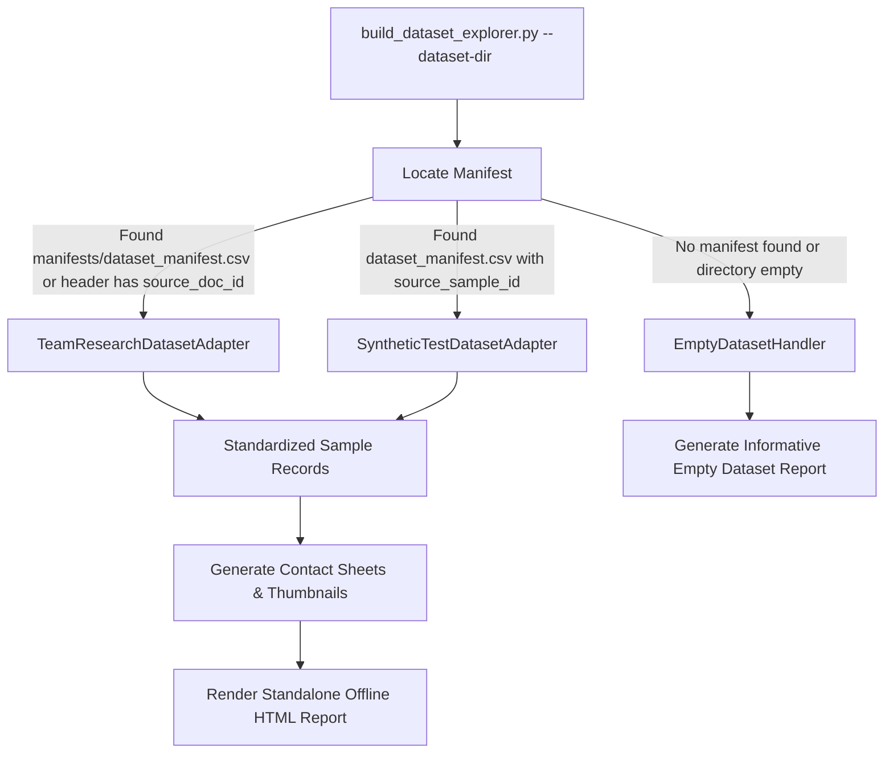

# FALCON-404: Dataset Format Specification & Architecture
**Standard Version:** 2.0 (Phase 7.1B)  
**Lead Architect:** Harshad Mane  
**Applies to:** `ml/scripts/build_dataset_explorer.py`, `validate_synthetic_dataset.py`, and ML Preprocessing Pipelines  

---

## 1. Executive Summary

FALCON-404 strictly segregates datasets into two distinct functional domains:
1. **Synthetic Test Dataset (`ml_data/phase7_synthetic/`)**: Generated programmatically for verifying generation, mask alignment, validation logic, and explorer tooling. Never used for model training or evaluation.
2. **Team Research Dataset (`ml_data/real_training_dataset/`)**: Collected physical photographs and controlled alterations of fictional mockups. Reserved for future ML training, validation, and testing.

The Dataset Explorer (`ml/scripts/build_dataset_explorer.py`) supports both formats natively through explicit schema adapters, enforcing strict path isolation, input sanitation, and zero-fallback guarantees.

---

## 2. Format 1: Synthetic Test Dataset

### Directory Layout
```
ml_data/phase7_synthetic/
├── images/                        # Generated RGB PNG images
├── masks/                         # Grayscale binary PNG masks (0 & 255)
├── dataset_manifest.csv           # Master CSV manifest
├── train.jsonl                    # Pre-partitioned training split
├── validation.jsonl               # Pre-partitioned validation split
├── test.jsonl                     # Pre-partitioned test split
├── generation.jsonl               # Append-only operation audit log
├── generation_config.json         # Run metadata & parameters
├── validation_report.json         # Automated validator output
└── reports/                       # Offline Explorer HTML reports
```

### Manifest Schema (`dataset_manifest.csv`)
| Column | Type | Allowed Values / Format | Description |
| :--- | :--- | :--- | :--- |
| `sample_id` | String | `ID_xxxx_PRISTINE` or `ID_xxxx_MANIP_<TYPE>` | Unique sample identifier |
| `source_sample_id` | String | `ID_xxxx` | Base identity identifier (anti-leakage grouping) |
| `template_type` | String | `ALPHA_CARD`, `BETA_CERTIFICATE`, `GAMMA_PERMIT` | Template visual family |
| `split` | String | `train`, `validation`, `test` | Central partition assignment |
| `label` | String | `pristine_synthetic`, `manipulated_synthetic` | Binary classification label |
| `manipulation_type` | String | `none`, `text_replacement`, `copy_move`, `portrait_swap`, `localized_resampling_blur`, `localized_recompression` | Forensic manipulation modality |
| `manipulation_bbox` | JSON String | `"[x, y, w, h]"` | Bounding box of altered area |
| `image_path` | String | `images/<sample_id>.png` | Relative path to image file |
| `mask_path` | String | `masks/<sample_id>_mask.png` | Relative path to ground-truth mask |
| `image_width` | Integer | Positive integer (e.g. `960`, `1000`, `900`) | Width in pixels |
| `image_height` | Integer | Positive integer (e.g. `600`, `700`, `640`) | Height in pixels |
| `altered_pixel_count`| Integer | $\ge 0$ ($0$ for pristine, $>0$ for manipulated) | Number of altered ($255$) pixels |
| `altered_pixel_ratio`| Float | $0.0 \le r \le 1.0$ | Fraction of altered canvas |
| `created_at` | ISO-8601 | e.g. `2026-10-18T17:18:24Z` | Generation timestamp |

---

## 3. Format 2: Team Research Dataset

### Directory Layout
```
ml_data/real_training_dataset/
├── README_START_HERE.txt          # Team instruction guide
├── images/
│   ├── unaltered/                 # Raw original camera photographs
│   └── altered/                   # Controlled digital/physical tamperings
├── masks/                         # Grayscale binary PNG masks (0 & 255)
├── manifests/
│   └── dataset_manifest.csv       # Master CSV manifest
├── metadata/
│   └── collection_log.csv         # Capture notes, camera devices, conditions
└── reports/                       # Generated offline Explorer HTML reports
```

### Manifest Schema (`manifests/dataset_manifest.csv`)
Template file located at `ml/templates/real_dataset_manifest_template.csv`.

| Column | Type | Required? | Allowed Values / Format | Description |
| :--- | :--- | :--- | :--- | :--- |
| `sample_id` | String | Yes | Alphanumeric (e.g. `M1_DOC001_C01_TEXT01`) | Primary key for sample |
| `source_doc_id` | String | Yes | Alphanumeric (e.g. `M1_DOC001`) | Physical document ID (anti-leakage root) |
| `member_id` | String | Yes | `M1`, `M2`, `M3`, `M4` | Team collector ID |
| `label` | String | Yes | `unaltered_mock`, `altered_mock` | Primary research classification |
| `manipulation_type`| String | Yes | `none`, `text_replacement`, `copy_move`, `portrait_swap`, `localized_resampling_blur`, `localized_recompression`, `splice`, `removal` | Manipulation modality |
| `image_path` | String | Yes | `images/unaltered/xxx` or `images/altered/xxx` | Relative path from dataset root |
| `original_image_path`| String | Conditional| `images/unaltered/xxx` | Source image path for altered samples; blank for unaltered |
| `mask_path` | String | Conditional| `masks/xxx_MASK.png` | Relative path to binary mask |
| `template_family` | String | No | e.g. `CARD_A`, `CERTIFICATE_B`, `PERMIT_C` | Visual document category |
| `capture_device` | String | No | e.g. `iPhone 13`, `Pixel 7`, `Sony Alpha` | Hardware device profile |
| `capture_condition`| String | No | e.g. `daylight`, `indoor_warm`, `angled_30deg` | Lighting and capture angle |
| `provenance` | String | Yes | `team_physical_capture`, `team_digital_alteration`, or external source | Curation origin |
| `license_or_permission`| String | Yes | `team_internal_research`, `cc0`, or approved external license | Legal / ethical research basis |
| `review_status` | String | Yes | `pending_review`, `approved`, `flagged` | Quality assurance sign-off |
| `image_width` | Integer | No | Positive integer | Width in pixels |
| `image_height` | Integer | No | Positive integer | Height in pixels |
| `notes` | String | No | Free text | Specific tampering details or notes |

---

## 4. Ground-Truth Mask Specifications

All masks across both formats adhere to these uniform specifications:

1. **File Type:** PNG format.
2. **Color Mode:** Single-channel grayscale (`L`).
3. **Dimensions:** Pixel dimensions must match the associated image exactly:
   $$\text{Width}_{\text{mask}} = \text{Width}_{\text{image}} \quad \text{and} \quad \text{Height}_{\text{mask}} = \text{Height}_{\text{image}}$$
4. **Permitted Pixel Values:** Strictly binary:
   - `0`: Untouched background / original pixels.
   - `255`: Modified / forged pixels.
   - Any pixel value $\notin \{0, 255\}$ is an invalid mask error.
5. **Unaltered Images:** All pixels are `0` (count of $255$ pixels must be exactly zero).
6. **Altered Images:** Altered pixel count must be $>0$.

---

## 5. Security & Path Resolution

To guarantee security and sandbox integrity when processing external or team manifests:
1. **Root Anchoring:** Every file path in a manifest is interpreted as relative to the selected dataset directory.
2. **Canonical Path Traversal Check:**
   $$\text{realpath}(\text{dataset\_dir} / \text{rel\_path}).\text{startswith}(\text{realpath}(\text{dataset\_dir}))$$
   Any path containing `../` or leading drive letters that resolves outside the dataset boundary is immediately rejected as an invalid / unsafe reference.
3. **HTML Sanitization:** All text fields rendered into HTML reports are processed through `html.escape()` to prevent script injection.

---

## 6. Adapter Architecture in Dataset Explorer

The Dataset Explorer dynamically inspects the manifest headers to select the matching adapter:



### Zero-Fallback Guarantee
If a selected dataset directory is empty or contains an invalid manifest, the Explorer:
- **Never** silently falls back to another dataset (e.g. synthetic data).
- Generates an explicit "Dataset Empty / Incomplete" report with exact zero counts and diagnostic guidance.
